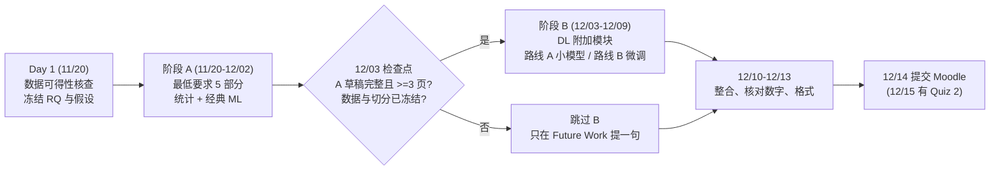

# 计划评审报告（v1 → v2）

> **评审对象：** `plans/plan_1` ~ `plan_5`（v1，2026-11-19 生成）
> **评审依据：** CS482 `Project-requirements`（Google Drive）中的 *Minimum Project Requirements*、报告格式与评分标准
> **评审日期：** 2026-11-19（距离 12 月 15 日截止还有 26 天；当天同时有 Quiz 2）
> **新增约束（用户要求）：** 每个计划都要 **先完成全部 Minimum Requirements（阶段 A）**，**再用阶段 A 处理好的数据** 训练一个小型 DL 模型，或微调一个预训练大模型，作为 **附加模块（阶段 B）**。

---

## 0. 使用的科研技能与评审方法

| 技能（K-Dense Scientific Agent Skills） | 在本次评审中的用途 |
| --- | --- |
| `scientific-critical-thinking`（含 `statistical_pitfalls.md`） | 评审流程：①固定研究问题与分析单元 → ②区分描述性/预测性/因果性结论 → ③检查选择偏差、混杂、依赖结构、配对 vs 独立检验、多重比较 → ④每个问题按“严重 / 重要 / 次要”分级并给出可行修改 |
| `statistical-analysis` & `statsmodels` | 假设检验选择、禁止仅凭诊断 p 值事后切换检验/模型（pretest switching）、相同响应与样本行才能比较 AIC/BIC、报告效应量与置信区间 |
| `scikit-learn` & `shap` | 数据泄漏、分组/时间/空间交叉验证、Pipeline 规范；SHAP 背景集必须来自训练集、明示输出空间与正类标签、校验可加性且不作因果解读 |
| `statistical-power`、`experimental-design` | 问卷计划（Plan 4）的样本量和分块选择实验设计 |
| `timesfm-forecasting` | 时间序列基础模型的用法边界：rolling-origin 评估；分位数区间只能标为“名义区间”（nominal） |
| `transformers` | 微调规范：按文档/时间/个体切分；softmax 分数不等于校准后的置信度；要记录版本与随机种子 |
| `torch-geometric` | 小图 GNN 的适用性；随机标签测试只能验证代码机制，不能说明学到了真实信号 |
| `scientific-writing` | 区分验证性（预注册假设）与探索性分析、核对分母/单位/绝对与相对效应、如实报告零结果与局限 |

另外，我对几条关键事实做了网络核实（见第 3 节 C5、C4）。

---

## 1. 总体结论

v1 计划的选题紧扣本地、方法很丰富，但有 **4 类系统性问题**：

1. **DL 和最低要求混在一起，没有分阶段：** 一旦 DL 部分卡住，最低要求也会跟着受影响。
2. **数据可得性没有核实：** 其中 Plan 1 的空气质量数据源存在 **致命错误**。
3. **结论措辞偏因果、偏夸大：** 预设了结论，比如“Cotai Price Cliff”“Target 35/35”。
4. **时间和篇幅都低估了：** 只剩 26 天；而 v1 每个计划都要 3 张图 + 2 张表 + 4 个以上模型，很容易超过 5 页上限。

v2 统一改成 **“阶段 A（最低要求，独立完整）→ 12/03 Go/No-Go 检查点 → 阶段 B（DL 附加模块）”** 的结构。

---

## 2. 跨计划共性问题（按严重程度）

### 🔴 严重（会威胁主要结论或项目能否完成）

| ID | 问题 | 后果 | v2 修改 |
| --- | --- | --- | --- |
| C1 | DL 被写进主分析链，没有设置“最低要求先完成”的保障 | DL 调参拖延会挤占最低要求；评分里 Problem Definition（35%）和 Data & Methodology（25%）都依赖完整的基础分析 | 拆成阶段 A / B；**12/03 检查点**：阶段 A 报告草稿要覆盖 5 个必需部分且 ≥3 页，否则放弃阶段 B |
| C4 | 关键数据源没有核实（SMG 历史小时数据、data.gov.mo 餐厅登记、DSEC 统计区边界等） | 第 2 周才发现拿不到数据，整个项目会失败 | 每个计划都加 **Day-1 数据可得性核查清单 + 备选数据源**；必要时 11/20 当天发邮件申请数据 |
| C5 | **Plan 1 把 Open-Meteo 空气质量 API 当作观测数据**。核实结果：澳门所在区域用的是 **CAMS Global 0.4°（约 45 km）、3 小时分辨率的模式预报值，不是站点实测** | 氹仔和半岛的坐标落在同一个网格里，“区域对比”这个研究问题就不成立；拿模式输出当真值会造成循环论证 | 改用 **SMG 站点观测** 作为目标变量；CAMS 只能作为“区域背景”协变量，而且必须标注来源 |
| C9 | 时间可行性：Plan 3、Plan 4 需要大量一手数据；**Plan 4 的采集窗口（11 月下旬）正值澳门旱季**，降雨变化极少 | 用实际行为数据（RP）估计降雨效应在统计上无法识别 | Plan 3 缩小范围、改用“标准化菜品价格实地审计”；Plan 4 改成 **规范设计的陈述偏好选择实验（DCE）**，RP 只用来做效度检验 |

### 🟠 重要（会影响结论解读）

| ID | 问题 | v2 修改 |
| --- | --- | --- |
| C2 | 措辞夸张、预设结论（“Target 35/35”“huge originality advantage!”“instructors love”“Cotai Price Cliff”） | 删除所有夸张表述；研究问题改写为 **可证伪的假设 H1/H2/H3**，可以接受零结果 |
| C3 | 从观测数据和 SHAP 推出因果结论（“drivers”“impact”“elasticity”） | 统一使用关联性措辞（“与……相关”“条件关联”）；明确说明 SHAP 解释的是 **模型行为**，不是因果效应；每个计划都写明结论边界 |
| C6 | 依赖结构与数据泄漏：时间序列的滑动窗口重叠、同一受访者的多条记录、空间自相关 | 统一规则：预处理只在训练折上拟合；超参数只在内层验证集上调；**测试集只评估一次**；分别使用 `TimeSeriesSplit`/rolling-origin、`StratifiedGroupKFold`、空间分块 CV |
| C7 | 统计检验：多步预测直接做 DM 检验、多个模型/时域/分层之间没有校正、只看 p 值 | 多步预测用 **HLN 修正的 DM 检验**；多重比较用 **Holm 校正**；报告效应量 + 95% CI；“不显著 ≠ 没有差异” |
| C8 | 不确定性：MC Dropout、分位数、conformal 在非可交换数据上被当作“已校准的 90% 区间” | 统一标注为 **名义区间（nominal）**，同时报告 **经验覆盖率 + 平均区间宽度** |
| C10 | 篇幅：v1 每个计划都安排 3 图 + 2 表 + 多模型，再加 DL 很容易超 5 页 | 篇幅预算：阶段 A ≈ 3.5–3.75 页；阶段 B ≤ 0.75 页（1 张小表 + 1 段文字）；总计 ≤ 4.75 页 |
| C11 | 方法堆砌（GMM + PELT + GAT + GAE + conformal + …），和研究问题的对应关系不清楚 | 每个方法都必须对应到一个具体的 H 或评估目标，否则删掉 |
| C15 | 统计细节缺陷：凭诊断 p 值事后切换检验/模型（pretest switching）；对自相关日差值或配对数据使用独立同分布检验（Wilcoxon / 独立 $\chi^2$）；SHAP 未指明背景集与输出空间；不同响应尺度直接比 AIC/BIC | OLS 与空间模型预先并列报告；自相关/配对数据改用 Newey–West HAC、block/cluster bootstrap 或 Stuart–Maxwell 检验；SHAP 固定从训练折抽背景集并校验可加性；仅在相同响应与观测行上比较 AIC/BIC |

### 🟡 次要

| ID | 问题 | v2 修改 |
| --- | --- | --- |
| C12 | 写了一些没核实过的具体事实（例如具体公交线路号） | 删除，或标注“待核实” |
| C13 | 问卷伦理：没有说明知情同意和是否需要伦理审批 | 加入匿名、自愿、18 岁以上的说明，并向任课老师确认是否需要审批 |
| C14 | 计划本身由 AI 生成 | 报告的 AI 使用声明要如实写明“项目构思阶段使用了 AI 辅助”，并说明是怎样核实的 |

---

## 3. 各计划专项问题

### Plan 1 — 空气质量预测
- 🔴 C5：Open-Meteo 空气质量数据是 CAMS 0.4° 模式值（已核实）。氹仔和半岛的对比只能基于 SMG 站点数据。
- 🔴 SMG 网站能确认有 **实时过去 1 小时浓度** 和 **2024–2026 年空气质量月报**，但 **能否批量下载历史小时数据还没确认** → Day 1 先查 data.gov.mo，同时给 `meteo@smg.gov.mo` 发邮件申请。备选方案：用月报/日均值做日尺度分析。
- 🟠 用未来时刻的再分析气象值做特征，相当于“完美天气预报”，属于泄漏 → 主分析只用预测时点已知的信息；“oracle 天气”只作为敏感性分析。
- 🟠 区域传输是 **假设**，没有轨迹数据无法证明 → 措辞降级为“北风条件下 PM2.5 偏高的关联”。
- 🟢 优势：数据量大（日尺度约 1,700 天，小时尺度约 4 万条），DL 有用武之地。

### Plan 2 — 旅游与酒店入住率
- 🟠 疫情后开关后只有约 45 个月数据，统计功效有限 → 用 4 个星级的面板回归 + Driscoll–Kraay 标准误；对比疫情前（2010–2019）系数，用交互项或 Chow 检验。
- 🟠 用同月旅客构成解释同月入住率，是 **事后解释**，不是预测 → 解释模型和 1 个月前瞻预测模型分开做。
- 🟠 样本量小，从零训练 DL 很可能不如基线 → 阶段 B **优先选“微调预训练时间序列基础模型”**（Chronos-Bolt/Chronos-2，通过 AutoGluon 的 `fine_tune=True`；已核实官方支持）。
- 🟡 GMM 聚类在约 200 个点上意义不大 → 改成 change-point 检测，只用于 EDA。

### Plan 3 — 校园周边餐饮
- 🔴 4 人在 3 周内收集 300–500 家餐厅和 2,500–5,000 条评论，不现实；批量抓取点评平台还可能违反服务条款（ToS）。
- 🔴 “Cotai Price Cliff”预设了结论（确认偏差）→ 改写为价格梯度假设 H1。
- 🟠 到 MUST 的出行时间和到度假村的距离高度共线，存在空间混杂 → 计算 VIF，报告两者的联合效应。
- 🟠 150 条人工标注只够 **评估**，不够 **微调** → 阶段 B 先在公开中文餐饮方面级情感数据集 **ASAP**（美团）上微调，再在澳门金标准集上测试迁移效果。
- 修改：一手数据改成 **“标准化菜品价格实地/线上审计”**（每家记录最便宜主食价格等），目标 150–250 家。

### Plan 4 — 天气与通勤
- 🔴 C9：旱季 + 回忆偏差，RP 数据无法识别降雨效应。
- 🟠 “最近 3–5 次出行”和逐小时天气精确匹配不可靠（回忆偏差）。
- 🟠 样本量：按 Orme 经验法则 \(N \ge 500c/(t\cdot a)\)（c = 最大水平数 4，t = 8 个任务，a = 4 个选项），N ≥ 63 只够估计主效应；如果要做“出发地 × 天气”的交互，需要 ≥150 → 目标 150–200。注意这只是经验法则，不是正式的功效分析。
- 修改：采用 **分块的分式析因 DCE** + 混合 logit（受访者随机效应）；用 SMG 10 年气候资料估计各天气情景出现的频率，对结果加权。
- 🟡 “Remote/Skip”选项涉及社会期许偏差 → 单独提问，并保持匿名。

### Plan 5 — 公共设施与充电桩空间公平
- 🔴 **循环论证：** v1 用 GAT 预测 2SFCA 可达性分数，但 2SFCA 本身就是设施位置和人口的确定性函数，用 ML 去“预测”一个公式没有科学意义。
- 🟠 用已有设施位置训练出来的模型，学到的是 **历史配置模式**，不是 **需求** → 阶段 B 改成“设施有无的节点分类”，并且明确说明“相似但未覆盖”的格网只是 **候选点**，不等于“应该建”。
- 🟠 约 300 个节点的小图，过拟合风险很高 → 空间分块 CV + 10 个随机种子 + 报告置信区间，并与 logistic / XGBoost 对比。
- 🟠 DSEC 统计区边界能否获取 → Day 1 核查；备选方案是 H3 格网 + OSM 建筑面积的分区人口估算（dasymetric），并说明高层建筑带来的偏差。

---

## 4. v2 统一结构（所有计划）

**阶段 B 统一规则（含 Colab 算力升级，所有模型严格 ≤ 5B 参数）：**
1. 只使用阶段 A **已冻结** 的处理后数据、特征和训练/验证/测试切分。
2. **算力与容量分离原则（防过拟合）：** 拥有 Colab L4 / A100 额度后，应把 **0.7B–4.0B（严格 ≤ 5B）** 的大参数预算用在 **路线 B（预训练基础模型 / 大语言模型 + QLoRA / LoRA 微调）** 上，借助大规模预训练先验并保护小样本泛化；**路线 A（从零训练）** 仍受样本量约束，参数适度上调至 **0.2M–20M**（配 `bf16`、Weight Decay、Dropout / DropEdge、Cosine LR、Early Stopping 与容量消融），绝不在小样本上盲目从零训练十亿级模型。
3. 必须和阶段 A 的最佳模型以及朴素基线放在 **同一张表** 里比较。
4. 至少跑 3–5 个随机种子（小图 GNN 跑 10 个种子），报告均值 ± 标准差。
5. **结果不如基线或 4B 模型未优于小模型时，也要如实报告**并分析原因（边际递减 / 小样本方差 / 领域偏移）。
6. 报告里占 ≤ 0.75 页，标题为 “Extension: Deep Learning Module”。

---

## 5. 修订后推荐排序与可行性总览（Colab ≤ 5B 版）

> **成功率说明：** 下表“成功率”为基于 26 天工期（至 12/14 提交）、3–5 人团队与数据可得性风险的**主观规划区间估计**（非统计概率），拆分为“达成最低要求（阶段 A）”与“达成全阶段最终目标（阶段 A + 阶段 B ≤ 5B）”。

| 排名 | 计划 | 阶段 B 旗舰模型（严格 ≤ 5B） | 数据获取难度 | 全阶段实现难度 | 最低要求成功率 | 最终目标成功率 | 核心前置风险 |
| --- | --- | --- | --- | --- | --- | --- | --- |
| **1** | **Plan 2 旅游与酒店** | `Chronos-2` (120M) / `Chronos-T5-Large` (710M) + `Qwen3-4B-Instruct-2507` (4.0B QLoRA) | ★☆☆☆☆ 很低 (1/5) | ★★☆☆☆ 中低 (2.5/5) | **92%–97%** | **85%–92%** | 仅需核对 DSEC 历史星级分类口径 |
| **2** | **Plan 5 空间公平** | `Qwen3-Embedding-4B` (4.0B LoRA) + `BGE-M3` (568M) 文本属性图 + `GATv2` (0.2M–1.5M) | ★★☆☆☆ 中低 (2/5) | ★★★☆☆ 中等 (3/5) | **86%–92%** | **80%–88%** | Day 1 核查 DSEC 统计分区边界与充电桩容量表 |
| **3** | **Plan 1 空气质量** | `PatchTST` (8M–20M) + `Chronos-T5-Large` (710M) + `Qwen3-4B-Instruct-2507` (4.0B QLoRA) | ★★★☆☆ 中等 (3/5) | ★★★☆☆ 中等 (3/5) | **70%–80%** （拿到站点数据后 **90%–95%**） | **65%–75%** （拿到后 **80%–88%**） | Day 1 能否拿到 SMG 2022–2026 站点历史数据；拿不到则 11/22 转 Plan 2 |
| **4** | **Plan 3 餐饮** | `Qwen3-4B-Instruct-2507` (4.0B QLoRA) / `Qwen3-Embedding-4B` (4.0B) vs `MacBERT-Large` (326M) | ★★★★☆ 中高 (4/5) | ★★★☆☆ 中偏高 (3.5/5) | **78%–86%** | **70%–80%** | 11/28 前需完成 150+ 家价格审计与 150+ 条双人金标准标注 |
| **5** | **Plan 4 通勤** | `FT-Transformer` (1.5M–4M) + `TabPFN` 微调 + `Qwen3-4B-Instruct-2507` (4.0B TabLLM QLoRA) | ★★★★★ 高 (4.5/5) | ★★★★☆ 中高 (4/5) | **65%–78%** （收齐 N≥150 后 **88%–93%**） | **60%–72%** （收齐后 **80%–86%**） | 11/23 前须发问卷、11/30 收齐 150–200 名分区均衡样本 |

> **工具引用说明：** 本次评审用到了 K-Dense Scientific Agent Skills。如果最终报告的方法设计实质上采纳了这些建议，可以在 References 或 AI 声明中引用：Kassis, T., Agarwal, V., He, Y., Patel, D., & Brueckner, A. M. (2026). *Scientific Agent Skills: A Library of Procedural Knowledge for Research Agents.* arXiv:2609.00065. https://doi.org/10.48550/arXiv.2609.00065
